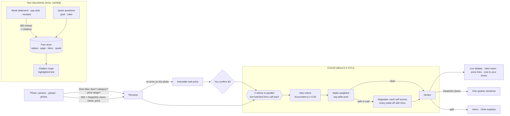

# Second Thoughts

**Your future selves weigh in before you pay.**

Snap a photo of something you're about to buy, with your laptop camera, an upload, or your phone. Four agents, your future selves, read **your own documents**, then argue, negotiate and agree on a verdict in about a second: **Buy**, **Buy with a condition**, or **Wait**. You can watch the debate live. Every vote cites the exact line it relied on, shown as a highlighted snip of your real document, and every price comparison links to where the price was found.

Built at **Drexathon 2026** · Track 2: **Swarm Intelligence**. Drex makes every agent's decisions.

## The four selves

| Self | Reads | Asks |
|---|---|---|
| 💳 **The Accountant** | Your bank statement and pay stub | Can I afford this before payday once my scheduled bills are paid? **Holds a veto.** |
| 🎯 **The Planner** | Your savings goal and your own spending rules (from a few quick questions) | Does this push back my goal or break a rule I set for myself? |
| 🧾 **The Minimalist** | Your receipts (they add up as you add more) | Do I already own something that does the same job? |
| 🏷️ **The Bargain Hunter** | The live web (Keenable) | Is this a good price, or would waiting or shopping elsewhere win? It links to where it found each price. |

## How you use it

1. **Whose money is this?** Upload your **bank statement** and **pay stub**, add **receipts** for things you own, and answer **a few quick questions**: what you're saving for, the target, how much you've saved, and any rules such as "no gadgets over $200 until my trip". **Your monthly saving is pre-filled** by analysing the savings transfers in your statement. Or try the demo persona (Maya).
2. **What do you want?** Upload a photo, use the laptop camera, or **📱 connect your phone** by scanning a QR code. **No price tag needed:** if the photo shows none, the app identifies the product, looks its price up on the web, shows the sources, and asks *"Is it about $X?"* before deciding.
3. **Watch the debate.** Each self speaks as its vote lands. If they disagree, each one scores every compromise ("resell your earbuds AND put $149 into the Japan fund") until all of them can live with one. Then comes the verdict: the condition, what it costs you in hours of take-home pay, and one spoken sentence.

Nothing is filled in silently. Missing documents are flagged, and a self that has no data **abstains** instead of guessing. A product it can't identify, or a price it can't read, produces a question, never a made-up number.

## Demo persona (Maya)

| Item | Verdict | Why |
|---|---|---|
| ASICS Gel-Nimbus 27, $109.95 | ✅ **Buy** | Affordable, running gear is exempt from her rule, and the price matches the typical low online |
| Sony WH-1000XM6, $349 | 🟡 **Buy, with a condition** | The Planner ("breaks your $200 gadget rule"), The Minimalist ("you already own $179 earbuds") and The Accountant ("$76 left for 13 days") object. Each picks **"resell the earbuds AND put $149 into the Japan fund"**, and pooled regret falls from 0.86 to 0.05 |
| Apple Mac mini, $599 | ⛔ **Wait: The Accountant's veto** | p(rent becomes unpayable) = 0.9995. The citation is the highlighted rent line on page 2 of her bank statement |

Two more fictional people for testing as a new user are in [`data/test_users/`](data/test_users/README.md): Jordan (a tight month) and Priya (comfortable). Each has a bank statement, a pay stub, receipts and `ANSWERS.md`, and there are product photos to check, including one with no price tag.

## Features

- **Live debate:** a transcript drawer where each self speaks, The Accountant announces vetoes, and each self answers during negotiation. It folds into a "💬 The debate" pill after the verdict.
- **Grounded citations:** NDI extracts every document with page and bounding box, and **Drex chooses which fact decided each vote**. The UI shows the cropped, highlighted line.
- **Price from anywhere:** price tags are read by NDI and a DeepInfra vision model in parallel, checked against Drex Max's own read of the price range, and converted if they're in another currency. With no tag, the price is looked up on the web and you confirm it. Photos can be HEIC (iPhone or macOS).
- **Price links:** The Bargain Hunter links to the listings where it found prices, cheapest first.
- **Phone camera:** scan a QR code. A temporary HTTPS link works from any phone on any network, and only the photo page is reachable through it. An iPhone near a Mac also works as a Continuity Camera.
- **Ask the Clerk:** Intern explains a split verdict in a paragraph.
- **Usage ledger:** live calls, latency and dollars per tool.

## How it works



**Each self is one Drex call** (`drex-max-v1.1`) with four batched questions:
1. `regret` (noul): "Will the buyer regret this, or will it cause them a problem, within 30 days?", with explicit true/false criteria per self
2. `stake` (score 0–10): how much this matters from that self's point of view; this is its pooling weight, capped at 5
3. `decisive_fact` (choice over the self's own fact ids): **Drex picks the citation**
4. A self-specific check: `bill_unpayable` (the veto), `breaks_rule`, `duplicate` or `wait_wins`

**The code computes the numbers. Drex judges them.** Free cash, days to payday, hours of take-home pay, goal slip and how far a price sits above the typical web price are all computed in Python and put into the `state`. Drex never does arithmetic. In the risk spikes, `drex-v2.0` put P(unpayable) at 0.52 for a $349 item against $425 free cash. With the computed headroom in the state, `drex-max-v1.1` gives 0.005.

**Veto:** The Accountant's `bill_unpayable ≥ 0.93` forces Wait. Nace reports that when Drex Max is at least 93% sure, it is right 97% of the time.

**Pooling:** weighted mean of `logit(p_regret)`, with weights = stake capped at 5. Bands: `< 0.35` Buy · `0.35–0.65` Buy with condition · `> 0.65` Wait.

**Negotiation, also all Drex:** when there is no veto and the result isn't a clear Buy, every self makes one more Drex call. It scores its regret under each templated trade-off (amounts computed in code: skip two takeout orders = $54, resell the earbuds ≈ +$90, …) and picks the one it prefers. A condition is accepted **only if it satisfies every self that objected**; otherwise the verdict stays Wait.

**Language models only write prose and read photos.** DeepInfra writes the spoken sentence and reads price tags. Intern writes the Clerk's explanation. None of them makes a decision.

## Results (honest version)

We benchmarked the council against simpler deciders that get **exactly the same facts and code-computed numbers**. Full details, confusion matrices and caveats are in [`backend/bench/RESULTS.md`](backend/bench/RESULTS.md).

**24 hold-out cards, labelled blind** before the current agent code was read. They include "wait" cases that aren't about bills.

| Method | Accuracy (95% CI) | Cost / verdict | Latency |
|---|---|---|---|
| **Drex council (ours)** | **75%** (58–92) | **$0.0005** | **0.47 s** |
| Frontier-LLM council (4× Qwen3.8-Max, same pooling, no negotiation) | 75% (54–92) | ~4× ours | ~4× ours |
| Single Drex call, given the band definitions | 71% (50–88) | | |
| Single Qwen3.8-Max call, given the band definitions | 67% (46–83) | | |
| Rules floor (3 lines of Python) | 67% (46–83) | | |

**What this shows:**
- The council **matches a frontier-LLM council at about a quarter of the cost and latency**.
- It made **0 false alarms**: it never said Wait when the label was Buy.
- It is the **most robust to wording**. With giveaway words like "OVER" and "EXCEEDS" removed from the facts, the council loses one card (71%), while the other model baselines fall to 58%.
- Every vote is grounded in a citation that Drex picked.

**What it doesn't show:**
- The council's lead over the simpler methods is **not statistically significant** at n=24.
- It is **weak on "wait" cases that aren't about bills**: it caught 2 of 6. Negotiation tends to turn them into "buy with a condition".
- When a single self is near-certain and outvoted by the others, it can be overruled, because each self's weight is capped. That's a known design issue.
- On our original 40-card development set the council scores 92% against 88% for the rules floor. We iterated on that set, so we don't count it as evidence.

How we got here: our first benchmark claimed 90%. An internal adversarial review showed the labels mostly reduced to "price > free cash", the baselines were too weak, and one change had been tuned to specific cards. We withdrew that claim and rebuilt the benchmark as above.

## Tool usage

| Tool | Where it's used |
|---|---|
| **Drex** (System One) | Perceive (Drex Max, image), all 4 votes, the veto, the citation choice, the negotiation scoring. That's 5–9 calls per verdict at about 350 ms median |
| **NDI** | Extracts your documents (bank statement, pay stub, receipts as PDF, photo, EML or text) with page and bbox citations, which become the highlighted crops; also reads price tags from photos |
| **Intern** | **In the product:** the Clerk, run headless (`intern -p --json`). It writes the persona facts summary at setup ([`docs/clerk_summary.md`](docs/clerk_summary.md)) and explains split verdicts in ~4 s. **As a coding agent:** given `AGENTS.md` as its spec, it wrote [`backend/tests/test_council_math.py`](backend/tests/test_council_math.py) (12 tests of the pooling, bands and trade-offs; 8 turns, 17 Drex System 1 decisions) |
| **Keenable** | Live web prices for The Bargain Hunter (with links to the listings), and the price lookup when a photo has no price tag |
| **DeepInfra** | Qwen writes the spoken verdict sentence; Qwen3-VL reads product names and price tags from photos; Qwen3.8-Max is the frontier baseline in the benchmark |

The live **usage ledger** in the UI shows calls, median latency and dollars per tool (`GET /api/ledger`).

**Tally while building and benchmarking** (from the ledger, 2026-11-14 12:06 PT):

| Tool | Calls | Errors | Median latency | Spend |
|---|---|---|---|---|
| Drex | 897 | 0 | 300 ms | $0.095 (792k input tokens) |
| NDI | 11 jobs | 0 | 6.2 s | $0.156 |
| Intern | 10 runs | 1 (an early timeout, since fixed) | 51 s (setup runs are long; explanations ~4 s) | — |
| Keenable | 33 searches | 0 | 2.0 s | — |
| DeepInfra | 23 calls (verdict sentences); about 400 more Qwen3.8-Max calls ran as benchmark baselines and aren't in the ledger | 0 | 1.1 s | — |
| **Total** | | | | **≈ $0.25** |

## Run it

Prerequisites: Python 3.12 via [uv](https://docs.astral.sh/uv/), Node 20+.

```bash
cp .env.example .env          # fill NACE_API_KEY and DEEPINFRA_API_KEY (Keenable works keyless)

# backend: --host 0.0.0.0 lets a phone on the same Wi-Fi reach it
cd backend && uv sync && uv run uvicorn app.main:app --host 0.0.0.0 --port 8000

# frontend (in another terminal)
cd frontend && npm install && npm run dev      # http://localhost:5173

# optional: phone link from any network (temporary HTTPS URL; only the photo page is exposed)
./scripts/phone_tunnel.sh
```

Open the app → **Ask my other selves** → upload your documents (or try the demo persona) → **📷 Check something**.

- **Frontend-only work needs no keys or backend:** open `http://localhost:5173/?mock=1`.
- **Presenter shortcuts (demo persona):** `1` `2` `3` pick an example, and `?run=headphones` (or `shoes` / `macmini`) starts a run on load.
- **Full test guide:** [`docs/TESTING.md`](docs/TESTING.md).
- **Tests:** `cd backend && uv run pytest tests -q` (offline).
- **Benchmark:** `cd backend && uv run python bench/run_bench.py --cards holdout_cards.jsonl`.

## Repo map

| Path | What |
|---|---|
| `docs/API.md` | Backend ⇄ frontend contract (streamed NDJSON events: `perceive`, `vote`, `say`, `negotiation`, `verdict`, `confirm_price`, …) |
| `AGENTS.md` | Spec for coding agents (Intern) |
| `backend/app/` | `council.py` (perceive, veto, pooling, negotiation, web price lookup), `agents/` (the four selves), `facts.py` (documents, quick-question answers, NDI fact store, crops), `tradeoffs.py`, `vision.py`, `phone.py`, `drex.py`, `ndi.py`, `keenable_client.py`, `voice.py`, `clerk.py`, `ledger.py` |
| `backend/bench/` | Blind hold-out cards, the development set, `run_bench.py`, `RESULTS.md` |
| `backend/tests/` | Offline tests: council math, price resolution, persona modes |
| `frontend/src/` | React UI: `Landing`, `Onboarding`, `DocsPanel`, `Camera`, `PhoneLink`, `PriceConfirm`, `Council`, `Debate`, `Verdict`, `Ledger`, `mock.ts` |
| `data/persona/` | Fictional demo documents for Maya Chen (`scripts/gen_persona.py`) |
| `data/test_users/` | Fictional test users Jordan and Priya, plus product photos (`scripts/gen_test_users.py`) |
| `spikes/FINDINGS.md` | Measured API behaviour and latencies from the risk spikes |

All persona and test-user data is invented. Your own uploads stay on your machine in `data/private/` (gitignored).
