<div align="center">

# ◐ Second Thoughts

### Your future selves weigh in before you pay.

*Snap the thing you want. Four versions of future-you read your own bank statement, pay stub and receipts, then argue live. You get **Buy**, **Buy with a condition**, or **Wait** in about a second, and every word of it is backed by a highlighted line from your own documents.*

<br/>


<br/>

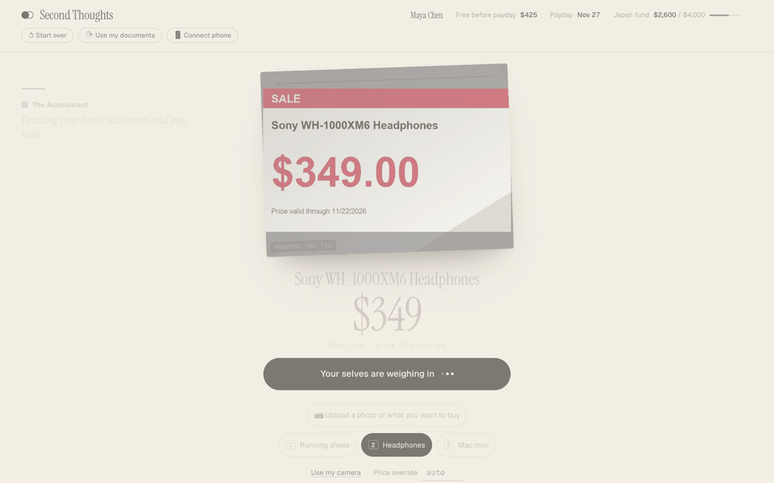

<sub>A real run, not a mock-up: the council disagrees 3 to 1, negotiates, and lands on <b>"resell the earbuds you already own and put $149 into the Japan fund."</b></sub>

<br/><br/>

<picture>
  <source media="(prefers-color-scheme: dark)" srcset="docs/media/charts/tiles-dark.svg"/>
  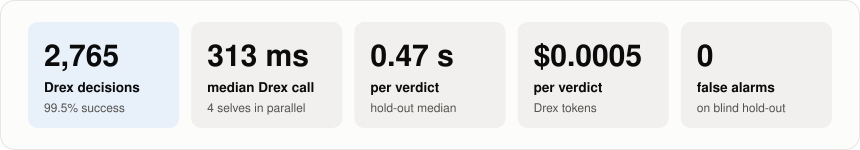
</picture>

</div>

---

## 💡 The idea

> **Your shopping cart has one voice. You have four.**

Every purchase is a quiet argument between who you are and who you want to become. Checkout pages are built to end that argument as fast as possible. **Second Thoughts lets it happen out loud**: with your real numbers, with receipts, in about a second.

It isn't a chatbot. It's a **council of perspectives that is allowed to disagree**. Each self sees only its own slice of your life, votes with a calibrated probability, cites the exact line it relied on, and has to **negotiate** with the others until every objection is answered, or the answer is *wait*.

## 🧑‍⚖️ Meet your council

| | Self | Reads | Asks | Super-power |
|:-:|---|---|---|---|
| 💳 | **The Accountant** | Bank statement · pay stub | *Can I afford this before payday, after the bills?* | **Veto.** If rent would bounce, nothing else matters. |
| 🎯 | **The Planner** | Your savings goal and your own rules | *Does this push back my goal, or break a rule I set?* | Holds you to the promises you made yourself |
| 🧾 | **The Minimalist** | Your receipts (they add up as you add more) | *Do I already own something that does this?* | Names the exact item you already own |
| 🏷️ | **The Bargain Hunter** | The live web, real retailers only | *Is this a good price, or will waiting win?* | Links to where it found the price |

## 📸 See it

<table>
<tr>
<td width="50%">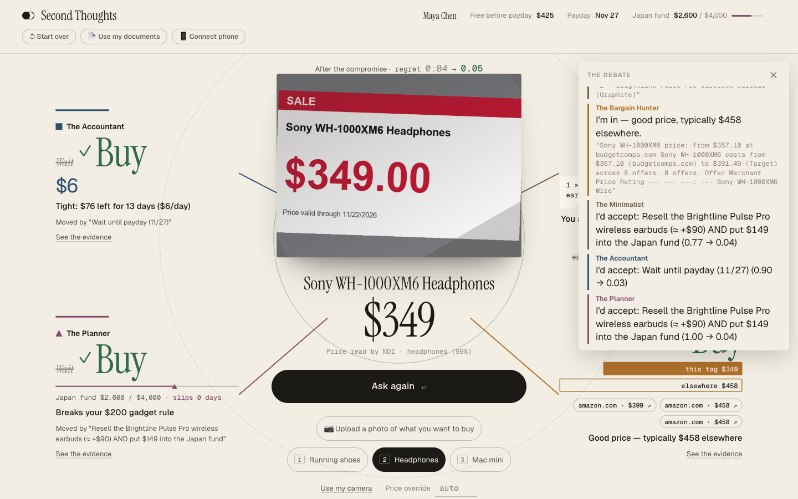<br/><sub><b>The debate.</b> Each self speaks as its vote lands, then each one scores the compromises.</sub></td>
<td width="50%">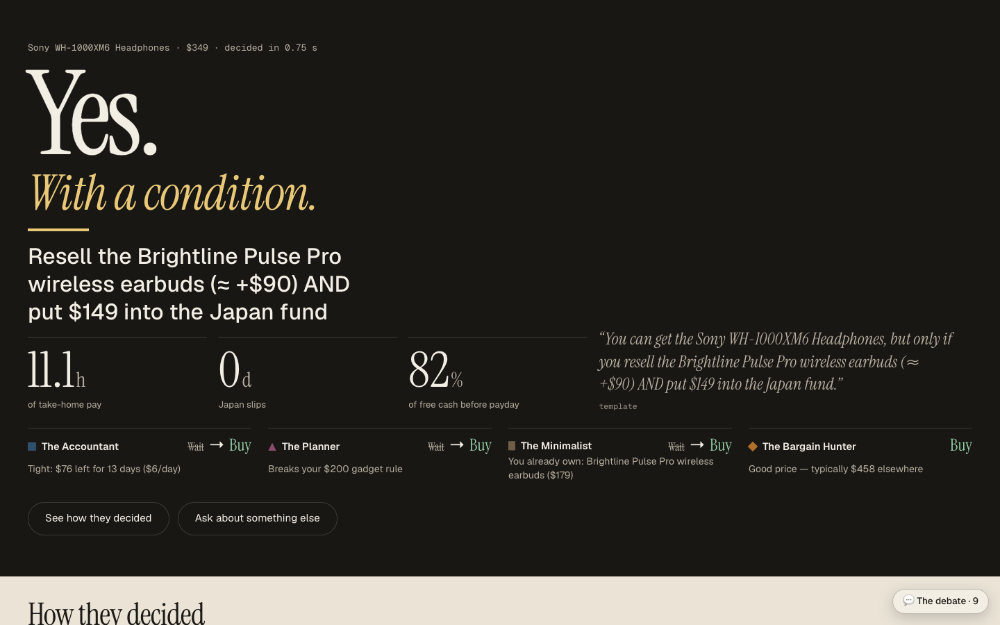<br/><sub><b>The verdict.</b> The condition, its cost in hours of take-home pay, and a spoken summary.</sub></td>
</tr>
<tr>
<td>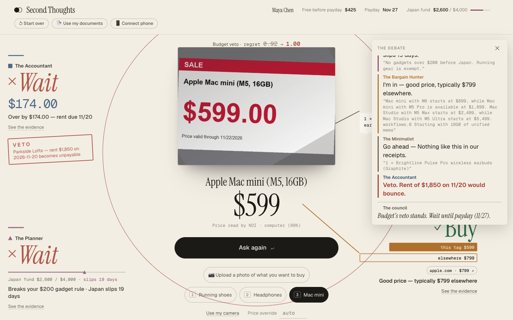<br/><sub><b>The veto.</b> <i>"Rent of $1,850 on 11/20 would bounce."</i> No negotiation.</sub></td>
<td>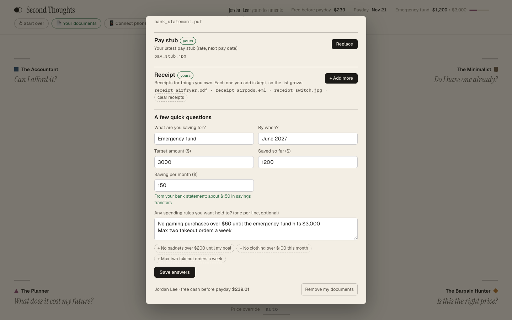<br/><sub><b>Your documents.</b> A bank statement, a pay stub, receipts that add up, and four quick questions. The monthly saving is read from your statement.</sub></td>
</tr>
<tr>
<td>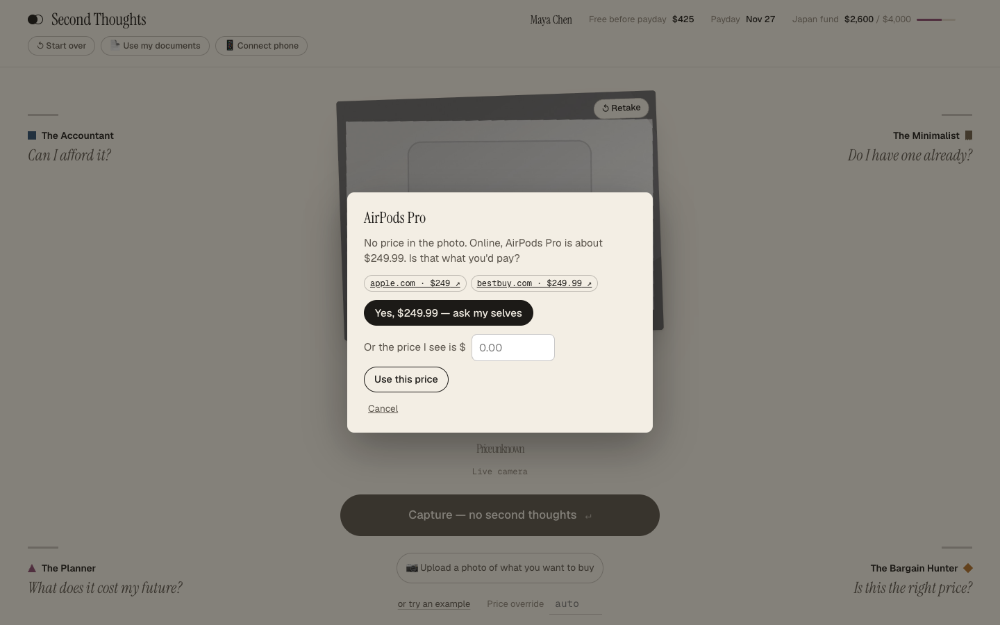<br/><sub><b>No price tag? No problem.</b> It identifies the product, checks real retailers, and asks <i>"Is it about $249?"</i></sub></td>
<td align="center">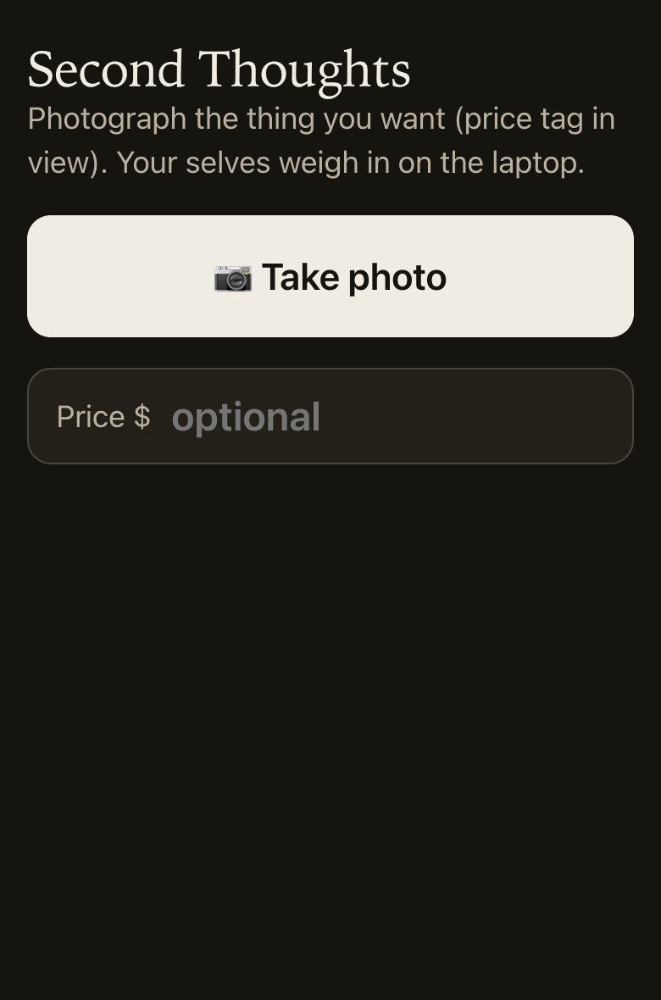<br/><sub><b>Use your phone.</b> Scan the QR code, snap a photo, and the laptop decides. It works from any network.</sub></td>
</tr>
</table>

## 🧭 How you use it

1. **Whose money is this?** Upload your **bank statement** and **pay stub**, add **receipts** for things you own, and answer **four quick questions**: what you're saving for, how much, by when, and any rules. Or meet **Maya**, the demo persona.
2. **What do you want?** Upload a photo, use the webcam, or **📱 connect your phone**. A price tag helps but isn't required.
3. **Watch them argue.** The debate streams live. If they disagree, they negotiate. You get the verdict, the reasons, the proof, and what it costs you in hours of work.

> **Nothing is ever filled in silently.** Missing documents are flagged. A self with no data **abstains** instead of guessing. A product it can't identify, or a price it can't read, produces a question, never a made-up number.

## ✨ Features

| | |
|---|---|
| 🗣️ **Live debate** | A transcript drawer of first-person lines. The Accountant announces vetoes, and each self answers every proposed compromise. |
| 📎 **Grounded citations** | NDI extracts each fact with its page and bounding box. **Drex chooses which fact decided each vote**, and the UI shows the highlighted crop of your real document. |
| 🤝 **Negotiation that has to convince** | A condition wins only if it satisfies **every self that objected**. Otherwise the answer is *wait*. |
| 🏷️ **Price from anywhere** | NDI and a vision model read the tag in parallel, checked against Drex Max's own read of the price range. Foreign currencies are converted. HEIC works. With no tag, the price is looked up on the web and you confirm it. |
| 🔗 **Real-retailer links** | The Bargain Hunter links to Amazon, Best Buy, Apple, REI and similar, cheapest first. Aggregators and redirect links are filtered out. |
| 📱 **Phone camera** | A QR code to a temporary HTTPS page that works on any network. Only the photo page is reachable through it: your documents return 403. |
| 🧾 **Ask the Clerk** | Intern explains a split verdict in a paragraph. It starts in the background as soon as the verdict lands. |
| 📊 **Usage ledger** | Live calls, latency and dollars per tool. |

## ⚙️ How it works

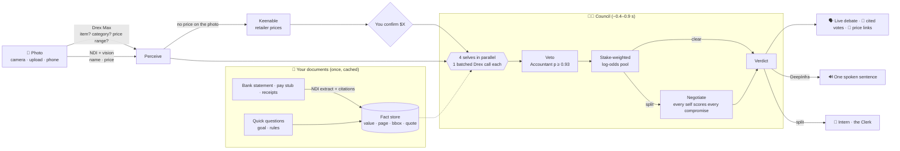

<details>
<summary><b>🔬 One verdict, step by step (sequence)</b></summary>

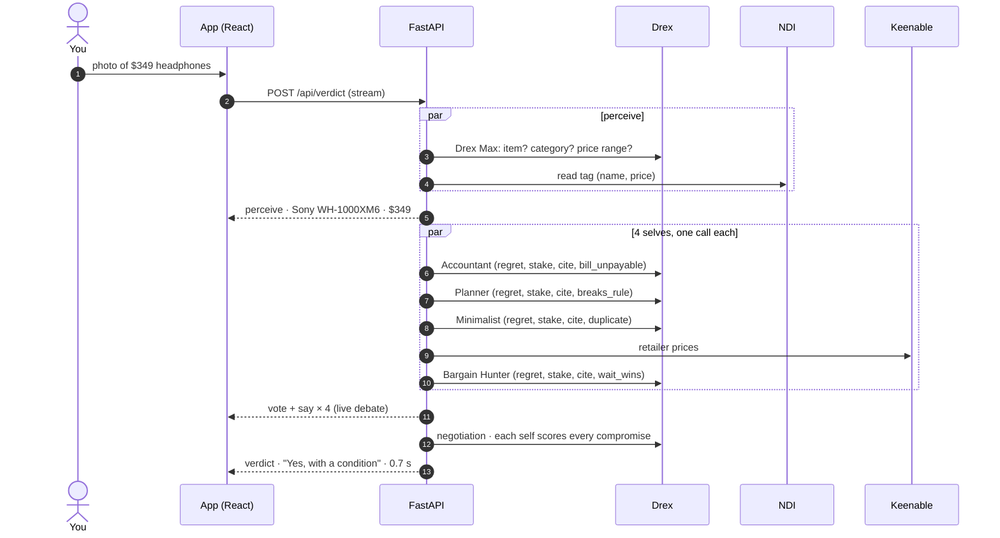
</details>

**Each self is one Drex call** (`drex-max-v1.1`) with four batched questions:

| Question | Type | Why |
|---|---|---|
| `regret` | noul | *"Will the buyer regret this within 30 days?"*, with explicit true/false criteria per self |
| `stake` | score 0–10 | How much this matters to that self. It's the pooling weight, capped at 5. |
| `decisive_fact` | choice over the self's own fact IDs | **Drex picks the citation.** That's where the explainability comes from. |
| per-self check | noul | `bill_unpayable` (the veto), `breaks_rule`, `duplicate`, or `wait_wins` |

- **The code computes the numbers. Drex judges them.** Free cash, days to payday, hours of take-home pay, goal slip and how far the price sits above typical are all computed in Python and put into the `state`. Drex never does arithmetic.
- **Veto:** `bill_unpayable ≥ 0.93` forces *Wait*. Nace reports that at 93% confidence Drex Max is right 97% of the time, so the threshold means what it says.
- **Pooling:** stake-weighted mean of `logit(p_regret)`. Bands: `< 0.35` Buy · `0.35–0.65` Buy with a condition · `> 0.65` Wait.
- **Negotiation:** one more Drex call per self scores its regret under each templated trade-off (amounts computed in code). A condition is accepted only if **every dissenter** drops below 0.5.
- **Language models only write prose and read photos.** DeepInfra speaks the verdict and reads price tags. Intern explains. **None of them decides.**

## 📈 Results: the honest version

We benchmarked the council against simpler deciders that get **exactly the same facts and code-computed numbers**. Only the decider changes.

<picture>
  <source media="(prefers-color-scheme: dark)" srcset="docs/media/charts/accuracy-dark.svg"/>
  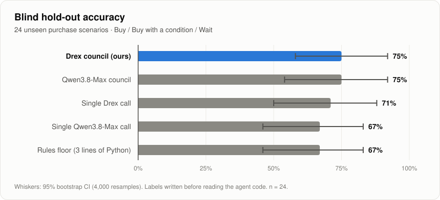
</picture>

<picture>
  <source media="(prefers-color-scheme: dark)" srcset="docs/media/charts/cost-latency-dark.svg"/>
  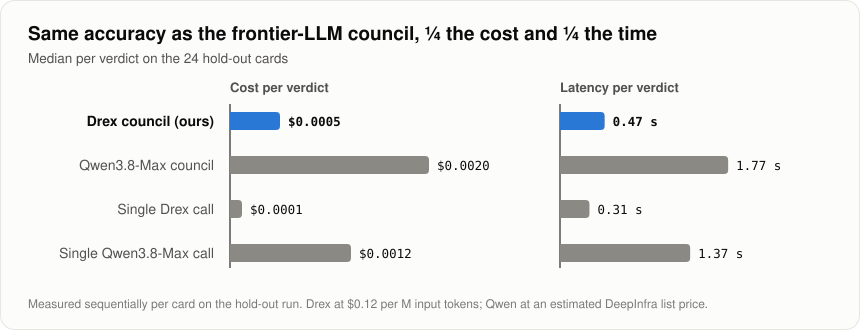
</picture>

<picture>
  <source media="(prefers-color-scheme: dark)" srcset="docs/media/charts/ablation-dark.svg"/>
  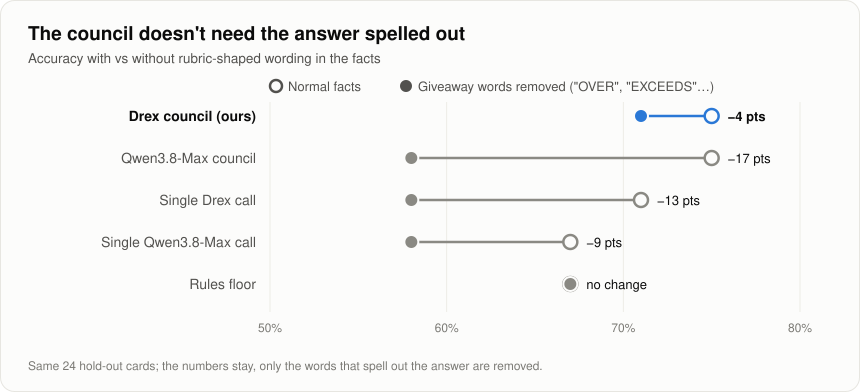
</picture>

| | Drex council | Qwen3.8-Max council | Single Drex | Single Qwen | Rules floor |
|---|:-:|:-:|:-:|:-:|:-:|
| **Hold-out accuracy** (n=24, blind) | **75%** | 75% | 71% | 67% | 67% |
| False alarms (said *wait* on a *buy*) | **0** | 0 | 2 | 2 | 0 |
| Accuracy without giveaway words | **71%** | 58% | 58% | 58% | 67% |
| Cost per verdict | $0.0005 | $0.0020 | $0.0001 | $0.0012 | $0 |
| Latency per verdict | 0.47 s | 1.77 s | 0.31 s | 1.37 s | 0 s |

**What this shows**
- ✅ It **matches a frontier-LLM council at about a quarter of the cost and latency.**
- ✅ It makes **zero false alarms** on blind cards.
- ✅ It is **the most robust when the wording stops spelling out the answer** (−4 pts vs −9 to −17). That's the strongest sign that splitting the decision into selves does real work.

**What it doesn't**
- ⚠️ At n=24 its lead over the simpler methods **isn't statistically significant**.
- ⚠️ It **catches only 2 of 6 "wait" cases that aren't about bills**, because negotiation tends to turn them into conditions.

> **How we got here.** Our first benchmark said **90%**. We then turned our own adversarial review agents on it, and they showed the labels mostly reduced to "price > free cash", the baselines were too weak, and one change had been tuned to specific cards. **We withdrew the claim** and rebuilt the benchmark from scratch: blind hold-out cards, fair baselines with band definitions, a rules floor, bootstrap CIs, and a wording ablation. Full details, confusion matrices and caveats are in [`backend/bench/RESULTS.md`](backend/bench/RESULTS.md).

## 🧰 Built on

| Tool | What it does here | Usage during the build |
|---|---|---|
| **Drex** | Every decision: perceiving the photo, the 4 votes, the veto, the citation choice, the negotiation scoring | **2,765 calls** · 99.5% success · **313 ms** median · 2.45M tokens · **$0.29** |
| **NDI** | Extracts your documents and price tags with page and bbox citations, which become the highlighted crops | 108 jobs · 5.1 s median · $1.10 |
| **Intern** | Coding agent: wrote the council-math tests from [`AGENTS.md`](AGENTS.md), making 17 Drex System 1 decisions along the way. In the product: **the Clerk** (`intern -p --json`) | 60 runs |
| **Keenable** | Live retailer prices, links, and price lookup when there's no tag | 164 searches · 2.0 s median |
| **DeepInfra** | Qwen3-VL reads tags from photos, Qwen writes the spoken verdict, Qwen3.8-Max is the frontier baseline | 230 calls · 1.1 s median |

## 🚀 Run it

**Prerequisites:** Python 3.12 via [uv](https://docs.astral.sh/uv/), Node 20+.

```bash
cp .env.example .env          # fill NACE_API_KEY and DEEPINFRA_API_KEY (Keenable works keyless)

# backend: --host 0.0.0.0 lets a phone on the same Wi-Fi reach it
cd backend && uv sync && uv run uvicorn app.main:app --host 0.0.0.0 --port 8000

# frontend (in another terminal)
cd frontend && npm install && npm run dev      # → http://localhost:5173

# optional: phone link from any network (temporary HTTPS URL; only the photo page is exposed)
./scripts/phone_tunnel.sh
```

**Open the app → Ask my other selves → upload your documents (or meet Maya) → capture.**

| | |
|---|---|
| 🎭 Frontend only, no keys | `http://localhost:5173/?mock=1` |
| 🎤 Presenter shortcuts (demo persona) | `1` `2` `3` run the examples · `?run=headphones` starts a run on load |
| 🖥️ The keynote deck | `open presentation/index.html` (**F** fullscreen, **D** opens the live demo) |
| 🧪 Tests | `cd backend && uv run pytest tests -q` (30 offline tests) |
| 📏 Benchmark | `cd backend && uv run python bench/run_bench.py --cards holdout_cards.jsonl` |
| 📖 Full test guide | [`docs/TESTING.md`](docs/TESTING.md) |

### 🧪 Try it as a new user
Two fictional people live in [`data/test_users/`](data/test_users/README.md), each with a bank statement, a pay stub, receipts and an `ANSWERS.md` cheat sheet:

| | Situation | Try |
|---|---|---|
| **Jordan Lee** | Tight month (~$239 free), building an emergency fund, owns a Switch | `tag_switch2.jpg` → **veto** (rent would bounce), plus *"we already own a Nintendo Switch OLED"* |
| **Priya Nair** | Comfortable (~$2,158 free), saving for a car, owns a Kindle | `tag_kindle_scribe.jpg` → *"we already own a Kindle Paperwhite"*, **buy with a condition** |

## 🗂️ Repo map

| Path | What |
|---|---|
| [`backend/app/`](backend/app) | `council.py` (perceive, veto, pooling, negotiation, web price lookup) · `agents/` (the four selves) · `facts.py` (documents, answers, NDI fact store, crops) · `tradeoffs.py` · `vision.py` · `phone.py` · `drex.py` · `ndi.py` · `keenable_client.py` · `voice.py` · `clerk.py` · `ledger.py` |
| [`frontend/src/`](frontend/src) | React UI: `Landing` · `Onboarding` · `DocsPanel` · `Camera` · `PhoneLink` · `PriceConfirm` · `Council` · `Debate` · `Verdict` · `Ledger` · `mock.ts` |
| [`backend/bench/`](backend/bench) | Blind hold-out cards, the development set, `run_bench.py`, [`RESULTS.md`](backend/bench/RESULTS.md) |
| [`backend/tests/`](backend/tests) | Offline tests: council math, price resolution, persona modes |
| [`presentation/`](presentation) | The four-slide keynote (HTML + PDF) |
| [`docs/`](docs) | [`API.md`](docs/API.md) (streamed events) · [`TESTING.md`](docs/TESTING.md) · media for this README |
| [`data/persona/`](data/persona) · [`data/test_users/`](data/test_users) | Fictional demo documents (Maya, Jordan, Priya) and product photos |
| [`scripts/`](scripts) | Persona and test-user generators, `phone_tunnel.sh`, `make_readme_charts.py` |
| [`spikes/FINDINGS.md`](spikes/FINDINGS.md) | Measured API behaviour from the first hour's risk spikes |

## 🔒 Privacy

Your documents never leave your machine except to be read by NDI. Uploads live in `data/private/`, which is gitignored. The public phone link can reach **only** the photo-upload page; documents, persona, crops and verdicts return **403** through it. All persona and test-user data in this repo is **invented**.

## 👥 Team

Built in one day at **Drexathon 2026** (Nace AI, San Francisco · Track 2: Swarm Intelligence) by **[Charan Sai](https://github.com/Charan0622)** and **[PowerStar007](https://github.com/PowerStar007)**.

Thanks to **Nace AI** for Drex, NDI and Intern, and to **Keenable** and **DeepInfra** for the partner credits.

<div align="center">
<br/>

### *The best purchase is the one you understand.*

</div>
