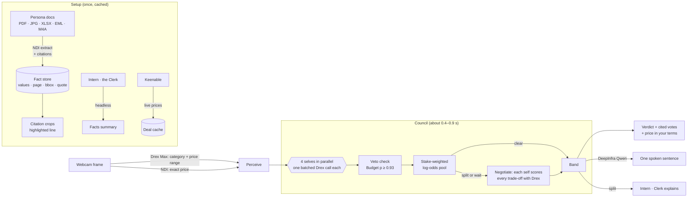

# Second Thoughts

**Your future selves weigh in before you pay.**

Point your webcam at something you're about to buy. Four agents, your "selves", vote and negotiate a verdict in **under a second**. Each self reads only its own documents. Every vote cites the exact line of your own documents it came from, shown as a highlighted snip of the real page.

Built at **Drexathon 2026** · Track 2: **Swarm Intelligence** (Drex makes every agent's calls).

| Self | Grounded in | Asks |
|---|---|---|
| 💳 **Budget You** | Bank statement (PDF), pay stub (photo) | Can I afford this before payday once the scheduled bills are paid? **Holds a veto.** |
| 🗾 **Goals You** | Savings tracker (XLSX), voice memo with my own rules | Does it delay my goal or break my own rule? |
| 🧾 **Already-Own-It You** | Receipt email (EML), paper receipt (photo) | Do I already own something like this? |
| 🏷️ **Deal You** | Live web via Keenable | Is this a good price, or will waiting (Black Friday) win? |

## Demo

| Item | Verdict | Why |
|---|---|---|
| ASICS Gel-Nimbus 27, $109.95 | ✅ **Buy** | Affordable, running gear is exempt from the rule, matches the typical low price online |
| Sony WH-1000XM6, $349 | 🟡 **Buy, with a condition** | Goals ("breaks your $200 gadget rule") and Already-Own-It ("you own $179 earbuds") dissent. Both independently pick **"resell the earbuds AND put $149 into the Japan fund"**, and pooled regret falls from 0.83 to 0.04 |
| Apple Mac mini, $599 | ⛔ **Wait: Budget veto** | p(rent becomes unpayable) = 0.9995. The citation is the highlighted rent line on page 2 of the bank statement |

## How it works



**Each self is one Drex call** (`drex-max-v1.1`) with four batched questions:
1. `regret` (noul): "Will Maya regret this, or will it cause her a problem, within 30 days?", with explicit true/false criteria per self
2. `stake` (score 0–10): how much this matters from that self's point of view; this is its pooling weight
3. `decisive_fact` (choice over the self's own fact ids): **Drex picks the citation**
4. A self-specific check: `bill_unpayable` (the veto), `breaks_rule`, `duplicate` or `wait_wins`

**The code computes the numbers. Drex judges them.** Free cash, headroom, hours of work and Japan-slip days are computed in Python and put into the `state`. Drex never does arithmetic. In the risk spikes, `drex-v2.0` put P(unpayable) at 0.52 for a $349 item against $425 free cash. With the computed headroom in the state, `drex-max-v1.1` gives 0.005.

**Veto:** Budget You's `bill_unpayable ≥ 0.93` forces Wait. Nace reports that when Drex Max is at least 93% sure, it is right 97% of the time.

**Pooling:** weighted mean of `logit(p_regret)`, weights = stake. Bands: `< 0.35` Buy · `0.35–0.65` Buy with condition · `> 0.65` Wait.

**Negotiation, also all Drex:** when there is no veto and the result isn't a clear Buy, every self gets one more Drex call. In it, the self scores its regret under each templated trade-off (fixed order, amounts computed in code: skip two takeout orders = $54, resell earbuds ≈ +$90, …) and picks the one it prefers. The trade-off with the lowest pooled regret becomes the condition.

**Language models only write prose.** DeepInfra (Qwen) writes the one spoken sentence, and Intern writes the Clerk's explanation. Neither makes a decision.

## Results

40 labelled scenarios (4 persona variants × 10 items). Every method gets the same facts and code-computed numbers; only the decider changes.

| Method | Agreement with labels | Critical errors | Median latency | Cost / verdict |
|---|---|---|---|---|
| **Drex council (ours)** | **36/40 (90%)** | **0** | **0.43 s** | $0.0006 |
| Single Drex call, all docs | 16/40 (40%) | 0 | 0.32 s | $0.0003 |
| Single frontier LLM (Qwen3.8-Max) | 13/40 (32%) | 0 | 1.75 s | $0.0013 |
| Frontier-LLM council (4× Qwen3.8-Max, same pooling) | 17/40 (42%) | 0 | 2.07 s | $0.0024 |

- **Splitting the decision into selves is what works.** Given everything at once, both single-call deciders say "wait" to 35–39 of the 40 cards.
- **On the same council structure, Drex beats the frontier LLM** at about 5× lower latency and 4× lower cost.
- **Every council vote cites a real document region that Drex picked.** The baselines give an unexplained verdict.

**Honesty note:** the first council run scored 70%. After that run we fixed two bugs in the trade-off offers and changed one rule (Deal You judges savings in dollars), then reran **all four** methods. The labels come from a single team-written rubric. Full caveats are in [`backend/bench/RESULTS.md`](backend/bench/RESULTS.md).

## Tool usage

| Tool | Where it's used |
|---|---|
| **Drex** (System One) | Perceive (Drex Max, image), all 4 votes, the veto, the citation choice, the negotiation scoring. That's 5–9 calls per verdict at about 350 ms median |
| **NDI** | Extracts all persona documents (PDF, photos, XLSX, EML, audio) with page/bbox citations, which become the highlighted crops; reads the price tag from the camera frame |
| **Intern** | **In the product:** the Clerk, run headless (`intern -p --json`). It writes the persona facts summary at setup ([`docs/clerk_summary.md`](docs/clerk_summary.md)) and explains split verdicts in ~4 s. **As a coding agent:** given `AGENTS.md` as its spec, it wrote [`backend/tests/test_council_math.py`](backend/tests/test_council_math.py) (12 tests of the pooling, bands and trade-offs; 8 turns, 17 Drex System 1 decisions) |
| **Keenable** | Live web prices and Black Friday signals for Deal You, cached per query |
| **DeepInfra** | Qwen writes the spoken verdict sentence; Qwen3.8-Max is the frontier baseline in the benchmark |
| **Adobe** | Firefly avatars for the four selves; Express for the slides |

The live **usage ledger** in the UI shows calls, median latency and dollars per tool (`GET /api/ledger`).

## Run it

Prerequisites: Python 3.12 via [uv](https://docs.astral.sh/uv/), Node 20+.

```bash
cp .env.example .env          # fill NACE_API_KEY and DEEPINFRA_API_KEY (Keenable works keyless)

# backend (first start extracts the persona docs with NDI, ~10 s, then caches them)
cd backend && uv sync && uv run uvicorn app.main:app --port 8000

# frontend (in another terminal)
cd frontend && npm install && npm run dev      # http://localhost:5173
```

**Frontend-only work needs no keys or backend.** Open `http://localhost:5173/?mock=1`. A built-in mock replays realistic event streams for all three demo items.

Keys: `1` `2` `3` (or ← →) pick a demo item. `?run=headphones` (or `shoes` / `macmini`) starts a run on load.

Tests: `cd backend && uv run pytest tests -q` (offline). Benchmark: `cd backend && uv run python bench/run_bench.py` (40 cards, about 5 min, about $0.20).

## Repo map

| Path | What |
|---|---|
| `docs/API.md` | Backend ⇄ frontend contract (streamed NDJSON events) |
| `AGENTS.md` | Spec for coding agents (Intern) |
| `backend/app/` | `council.py` (veto, pooling, negotiation), `agents/` (four selves), `facts.py` (NDI fact store and crops), `tradeoffs.py`, `drex.py`, `ndi.py`, `keenable_client.py`, `voice.py`, `clerk.py`, `ledger.py` |
| `backend/bench/` | `cards.jsonl` (40 labelled scenarios with reasons), `run_bench.py`, `RESULTS.md` |
| `frontend/src/` | React UI: `Camera`, `Council`, `Gauge`, `Verdict`, `Ledger`, `mock.ts` |
| `data/persona/` | Fictional demo documents for Maya Chen (`scripts/gen_persona.py`) |
| `spikes/FINDINGS.md` | Measured API behaviour and latencies from the risk spikes |

All persona data is invented. No real personal or financial data is used.
